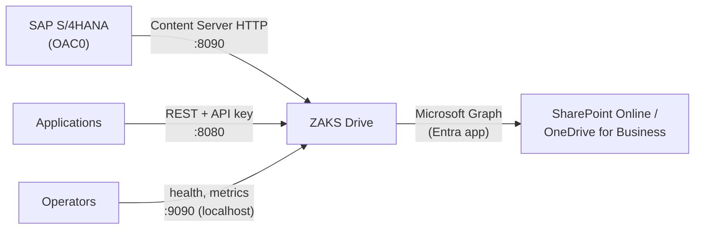

# ZAKS Drive

**Open-Source Enterprise Content Gateway**

Connect SAP S/4HANA and enterprise applications to Microsoft SharePoint Online and OneDrive for Business—without building custom storage integrations.

ZAKS Drive is a lightweight, self-hosted content gateway that provides an SAP-compatible Content Server interface and a REST API for storing, retrieving, and managing documents through Microsoft Graph. Documents are stored in your SharePoint document library or OneDrive, so they stay under the Microsoft 365 security, retention and backup you already run.

Two independent interfaces; use either one or both:

- **SAP Content Server HTTP interface** for SAP DMS, KPro and applicable attachment scenarios (OAC0 content repositories).
- **REST API** for Fiori applications and other enterprise applications.

ZAKS Drive is a content storage gateway, not a document management application: it has no user interface, workflow or business metadata of its own.

[](https://github.com/Lamiv/zaks-drive/actions/workflows/ci.yml)
[](LICENSE)
[](go.mod)

> **Status: pre-release.** The protocol layer is tested against SAP's standard reports and a real SharePoint tenant, and a DMS original has been stored and retrieved end to end, but GOS and ArchiveLink are not yet tested. Read [what is verified](#what-is-verified) before relying on it.

## What it is

ZAKS Drive is one small Go service in a Docker container. SAP sees it as an HTTP content server (transaction OAC0); your own applications see a REST API. Each interface works on its own, and both store documents in a SharePoint document library through Microsoft Graph. There is no database to run.

## Why it exists

- SAP can store documents in an HTTP content server, but SharePoint does not speak that protocol.
- Microsoft Graph is powerful but has limits (paths, folder sizes, throttling, upload sessions) that every integration must handle again.
- ZAKS Drive does that once: it implements SAP's protocol, respects SharePoint's limits, and gives every failure a code with the cause and the fix.

## Features

- **SAP Content Server HTTP 4.5** (pVersion 0045 to 0047): create, read, update, append, delete, search, multi-document create, certificate exchange, signed URLs (DSA, RSA, ECDSA).
- **REST API** with uploads (large files via upload sessions), downloads with ranges, folders, versions, thumbnails, search, paging, ETags.
- **Authentication:** API keys with per-key permissions and repositories, optional JWT; SAP signature verification with certificate activation.
- **SharePoint-aware storage:** sharded folders for SAP documents, name and path limit handling, version history, recycle-bin recovery.
- **Operable:** health and readiness endpoints, Prometheus metrics, JSON logs with request IDs, an access checklist (`zaks-drive check`), and [error codes](docs/error-codes.md) with cause and fix.
- **Small and constrained:** static binary, distroless non-root image, read-only root filesystem, bounded memory.

## Use cases

| You want to... | Use |
|---|---|
| Keep SAP DMS, GOS or ArchiveLink documents in SharePoint instead of a dedicated content server | The SAP Content Server interface (DMS originals [verified end to end](#what-is-verified); GOS and ArchiveLink not yet tested) |
| Let a Fiori app, a CAP service or a script store and fetch files without writing Graph code | The REST API |
| Give auditors and users the usual Microsoft 365 tools (search, retention, versions, recycle bin) over SAP documents | SharePoint as the store; ZAKS Drive is the bridge |
| Run it on your own server, with no extra database | One container, state only in SharePoint |

## Requirements

- A Linux host with Docker Engine and Compose v2 (2 vCPU and 2 GB RAM is a reasonable start; the container is limited to 1 GB).
- A Microsoft 365 tenant with SharePoint Online or OneDrive for Business, and an administrator who can register an Entra application and grant admin consent.
- For SAP: an S/4HANA system (the protocol layer was tested on S/4HANA 2025), SAP Basis access to OAC0 and STRUST, and network access from SAP to port 8090.
- Go 1.25 only if you build outside Docker.

## What is verified

| Capability | Status | Evidence |
|---|---|---|
| REST API (upload, download, folders, versions, search) | Verified | Automated tests with a Graph emulator; checked on a real tenant |
| SharePoint site and OneDrive access, `Sites.Selected` | Verified | `zaks-drive check` on a real tenant |
| SAP Content Server commands and signed URLs | Verified | SAP reports RSCMSTH0, RSCMSTH1, RSCMSTH2, RSCMSTH3, RSCMSTA0, RSCMSTAC passed on S/4HANA 2025 (2026-10-16) |
| SAP DMS originals (CV01N, CV03N) | Verified | Successfully tested end-to-end: document upload from SAP S/4HANA, storage in SharePoint Online through ZAKS Drive, and retrieval from SAP. Tested by the project owner on one system; the exact SAP customising used is [not yet documented](docs/sap/dms-integration.md) |
| GOS attachments, ArchiveLink | **Not tested** | Same protocol commands; [see notes](docs/sap/kpro-gos-archivelink.md) |
| RSCMSTAT (transport), RSCMSTHS | Not run | |
| `attrSearch`, CSADMIN (`adminContRep`) | Not implemented | Answer 501 |
| Entra certificate authentication | Not implemented | [Roadmap](ROADMAP.md) |
| Document browsing UI | Not provided | API and SAP interface only |
| High availability, Kubernetes manifests | Not tested / not provided | |
| arm64 | Cross-compiles; untested on hardware | |

This is not an SAP certification and not a security audit.

## Architecture



Details: [architecture](docs/architecture.md).

## Quickstart

No Microsoft 365 tenant or SAP system needed; this uses a bundled Graph emulator.

```bash
git clone https://github.com/Lamiv/zaks-drive.git zaks-drive && cd zaks-drive
docker compose -f loadtest/docker-compose.yml up -d --build graphmock adapter

curl -sS -H "X-API-Key: loadtest-key" http://localhost:8080/api/v1/repositories
echo "hello" | curl -sS -X POST -H "X-API-Key: loadtest-key" --data-binary @- \
  "http://localhost:8080/api/v1/repositories/DMS/documents?folder=demo&fileName=hello.txt"
curl -sS 'http://localhost:8090/ContentServer/ContentServer.dll?serverInfo&pVersion=0047'
```

More: [quickstart](docs/quickstart.md).

## Install for real

1. Register a Microsoft Entra app and grant it access to one SharePoint site: [Entra](docs/microsoft-365/entra-app-registration.md), [permissions](docs/microsoft-365/graph-permissions.md).
2. Copy `deploy/.env.example` to `deploy/.env` and `deploy/config.example.yaml` to `deploy/config.yaml`; set the tenant, client, secret and SharePoint location.
3. Start and verify:

```bash
docker compose -f deploy/docker-compose.yml up -d --build
docker compose -f deploy/docker-compose.yml exec adapter /zaks-drive check
```

Full guide: [installation](docs/installation.md), [configuration reference](docs/configuration.md).

## Connect SAP S/4HANA

Enable the `contentrepo` interface, create repository `Z1` in OAC0 (storage type 04, version 0047), send SAP's certificate, activate it with `zaks-drive certs activate`, and run SAP's `RSCMST` reports. Step by step: [Connect SAP S/4HANA to SharePoint using ZAKS Drive](docs/sap/connect-s4hana-to-sharepoint.md).

## Use the REST API

```bash
curl -sS -X POST -H "X-API-Key: $KEY" -H 'Content-Type: application/pdf' --data-binary @invoice.pdf \
  "http://localhost:8080/api/v1/repositories/DMS/documents?folder=invoices/2026&fileName=invoice-1001.pdf"
```

Guide with examples: [REST API](docs/api/rest-api.md). Contract: [openapi.yaml](docs/api/openapi.yaml).

## Security

ZAKS Drive runs as one Entra application with the narrowest permission that fits (`Sites.Selected` plus a site grant is supported). Secrets belong in `deploy/.env`, which is git-ignored. Port 9090 listens on localhost only. TLS, network exposure and API key hygiene depend on your deployment. See [security](docs/operations/security.md) for what is implemented, what depends on you and what is missing. Report vulnerabilities as described in [SECURITY.md](SECURITY.md).

## Performance

With the Graph emulator adding 60 to 140 ms per Graph call, one container limited to 2 CPUs and 1 GiB served 100 concurrent clients with 0% errors, using about 0.4 core and 350 MB. These numbers measure ZAKS Drive, not Microsoft Graph or your network. Method and tables: [load test results](docs/development/load-test-results.md).

## Configuration at a glance

| File | Holds | Committed? |
|---|---|---|
| `deploy/.env` | Entra tenant, client and secret, SharePoint site, library and root folder, API keys, admin token | Never (git-ignored) |
| `deploy/config.yaml` | Interfaces, repositories, limits, SAP repositories, authentication | Never (git-ignored); start from `config.example.yaml` |

```dotenv
SHAREPOINT_SITE_URL=https://contoso.sharepoint.com/sites/SAP_DOCS
SHAREPOINT_LIBRARY=Documents
SHAREPOINT_ROOT_PATH=SAP_DMS
```

Every setting, default and environment variable: [configuration reference](docs/configuration.md). Wrong values fail early, all at once, with a code and a fix.

## Compatibility

| Item | Supported |
|---|---|
| SAP Content Server HTTP | pVersion 0045, 0046, 0047 |
| Microsoft | SharePoint Online and OneDrive for Business through Microsoft Graph v1.0; organisational tenants only |
| Graph permissions | `Sites.Selected` with a site grant, `Sites.ReadWrite.All`, or `Files.ReadWrite.All` for OneDrive |
| Platform | Linux containers, amd64 tested; arm64 cross-compiles only |
| Not supported | On-premises SharePoint Server, consumer OneDrive, CMIS |

Upgrading from the earlier "SharePoint Adapter" name keeps configuration, ports, routes and volumes unchanged: [branding and compatibility](docs/development/branding-and-compatibility.md).

## Repository layout

```text
cmd/adapter        the zaks-drive binary (server, check, certs, errors, version)
cmd/graphmock      Microsoft Graph emulator for tests and demos
internal/          packages: config, auth, graph, storage, transfer, restapi, contentrepo, apperr, ...
deploy/            Dockerfile target, Compose file, .env and config examples
docs/              all documentation (start at docs/index.md)
loadtest/          k6 scenarios and runner
scripts/           access check, smoke test, documentation link checker
```

## FAQ

**Does it need a database?** No. Documents, SAP metadata and SAP certificates are all stored in SharePoint.

**Can SAP users see their SharePoint permissions applied?** No. SharePoint sees one application identity. SAP decides who may access what and signs the URLs; see [security](docs/operations/security.md).

**Why are SAP documents in folders with odd names?** SharePoint struggles above about 5,000 items per folder, so SAP documents are sharded over 256 folders by document ID. Treat that folder as owned by ZAKS Drive.

**Is there a web interface?** No. Use SharePoint to browse files, or build a frontend on the [REST API](docs/api/rest-api.md).

**Is it production ready?** Not yet claimed. See [what is verified](#what-is-verified) and the [release process](docs/development/release-process.md).

**Is it SAP certified?** No. It is an independent project; see the [disclaimer](#disclaimer).

## Documentation

Start at the [documentation index](docs/index.md).

| Topic | Page |
|---|---|
| Install and configure | [installation](docs/installation.md), [configuration](docs/configuration.md) |
| SAP | [overview](docs/sap/overview.md), [Content Server reference](docs/sap/content-server.md), [OAC0](docs/sap/oac0-configuration.md) |
| Microsoft 365 | [Entra](docs/microsoft-365/entra-app-registration.md), [permissions](docs/microsoft-365/graph-permissions.md), [SharePoint](docs/microsoft-365/sharepoint-configuration.md) |
| Operations | [deployment](docs/operations/deployment.md), [monitoring](docs/operations/monitoring.md), [backup](docs/operations/backup-recovery.md) |
| Errors | [error codes](docs/error-codes.md) |
| Development | [local development](docs/development/local-development.md), [testing](docs/development/testing.md) |

## Roadmap

See [ROADMAP.md](ROADMAP.md): it separates what is verified, what is under development and where contributors are wanted. Items are not promises. Releases: [CHANGELOG](CHANGELOG.md).

## Join the Community

ZAKS Drive is open source and built for the community. Whether you are an SAP developer, an integration engineer or a Go contributor, you are welcome to improve the code, extend integrations, fix bugs, write documentation and help shape the project's direction.

ZAKS Drive is an open-source project built to make enterprise document storage integration more accessible. We welcome code contributions, integration improvements, documentation, testing and technical discussions.

**Ways to participate:**

- **Contribute code:** fix bugs, improve performance or extend supported integrations.
- **Share SAP experience:** test with different S/4HANA releases, DMS configurations and Content Server scenarios, and report what worked.
- **Improve documentation:** add deployment guides, ABAP and Fiori examples and troubleshooting knowledge.
- **Discuss ideas:** collaborate on enhancements and architecture in GitHub Discussions (once the owner enables it) and in [RFCs](docs/rfcs/README.md).
- **Help other developers:** answer questions, reproduce issues and review proposed solutions.

Contributions are developed openly through GitHub Issues, Discussions and pull requests, and follow the [contribution guidelines](CONTRIBUTING.md) and the automated checks that run on every pull request. Start with a [`good first issue`](https://github.com/Lamiv/zaks-drive/labels/good%20first%20issue) or [`help wanted`](https://github.com/Lamiv/zaks-drive/labels/help%20wanted), or file an [SAP test report](https://github.com/Lamiv/zaks-drive/issues/new?template=sap_test_report.md).

The project currently has a single maintainer; see [GOVERNANCE.md](GOVERNANCE.md) for how decisions are made and how contributors can become reviewers and maintainers. Please follow the [Code of Conduct](CODE_OF_CONDUCT.md). Questions: [SUPPORT.md](SUPPORT.md). Report vulnerabilities privately: [SECURITY.md](SECURITY.md).

## License

[MIT](LICENSE). The copyright and permission notice must be kept in copies of the software.

## Disclaimer

ZAKS Drive is an independent open-source project and is not affiliated with, endorsed by, or certified by SAP SE or Microsoft Corporation. SAP, SAP S/4HANA, Microsoft, SharePoint, and other referenced product names are trademarks of their respective owners.
