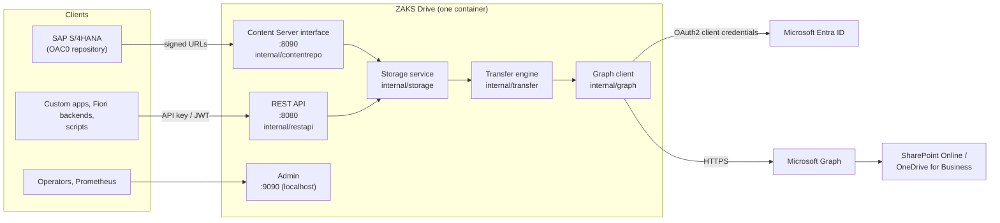

# Architecture

ZAKS Drive is one Go program (`cmd/adapter`, built as the binary `zaks-drive`) that exposes two independent interfaces over a shared Microsoft Graph client.



## Components

| Package | Responsibility |
|---|---|
| `cmd/zaks-drive`, `internal/ctl` | The management command on the host: setup, start/stop, logs, doctor, update, rollback, support bundle ([cli guide](cli.md), [design](development/cli-design.md)) |
| `internal/safelog` | The logging policy: what may be logged, redaction of text shown to people |
| `deploy` | Embedded deployment templates (compose for released installs, Dockerfile.release, config and .env examples) |
| `cmd/adapter` | Command line (`serve`, `check`, `certs`, `errors`, `version`), listeners, start-up, graceful shutdown. Also the Docker health check |
| `internal/config` | YAML and environment configuration, defaults, validation that reports every problem at once |
| `internal/auth` | Inbound authentication (API keys, JWT) and the Entra token source for Graph |
| `internal/graph` | Microsoft Graph client: retries, `Retry-After`, throttling, concurrency limit, drive resolution, error classification |
| `internal/storage` | Repository abstraction over a drive: names, paths, folders, versions, search, paging with signed cursors |
| `internal/transfer` | Uploads and downloads: simple upload, upload sessions in 320 KiB-multiple chunks, spooling, memory budget |
| `internal/restapi` | The REST API |
| `internal/contentrepo` | The SAP Content Server HTTP interface: commands, secKey verification, certificates, sidecar metadata, admin endpoints |
| `internal/apperr` | Error catalogue: code, cause, fix, HTTP status. The source of [error codes](error-codes.md) |
| `internal/observability` | Request IDs, access log, Prometheus metrics |
| `internal/accesscheck` | The `check` command |
| `internal/graphmock`, `cmd/graphmock` | A Graph emulator for tests, load tests and the [quickstart](quickstart.md) |

The Go module is `github.com/Lamiv/zaks-drive`; the internal packages keep their names ([branding and compatibility](development/branding-and-compatibility.md)).

## Request flow

**REST upload.** The API authenticates the key and checks permission and repository, the storage service validates the name and path against SharePoint limits, and the transfer engine sends small files in one request and larger ones through an upload session. Memory is bounded by a budget; unknown-size bodies spool to disk.

**SAP create.** The Content Server interface checks the source network, parses the command, verifies the `secKey` against the activated certificate, then writes the component file and the document's `~sapdoc.json` through the same storage service. A failure rolls the document back.

## Storage model

There is no database. SharePoint holds everything:

```text
<library>/<rootPath>/                       REST files and folders
<library>/<rootPath>/ContentServer/<contRep>/<shard>/<docId>/<compId>
                                           ~sapdoc.json   (content type, version, docProt)
<library>/<rootPath>/ContentServer/<contRep>/~certs/      (SAP certificates, activation)
```

`<shard>` is the first byte of SHA-1(docId) in hex, so no folder grows past about 5,000 items. Details: [storage layout](sap/content-server.md#storage-layout).

## Concurrency and limits

- Per-document locks inside an instance; `If-Match` with bounded retries across instances.
- A semaphore caps parallel Graph calls (`graph.maxConcurrency`); Graph `429/503` answers are retried with the `Retry-After` delay.
- A request cap per listener (`server.maxInFlight`) answers 503 beyond it.
- A memory budget semaphore with size-classed buffers bounds transfer memory.

## Security boundaries

ZAKS Drive runs as one Entra application, so SharePoint sees one identity. Authorisation of individual users is SAP's (signed URLs) or the calling application's (API key permissions). See [security](operations/security.md).

## What is not in the architecture

No document frontend, no database, no queue, no cache server, no CMIS (SharePoint does not support it), no SAP Gateway/OData service.
