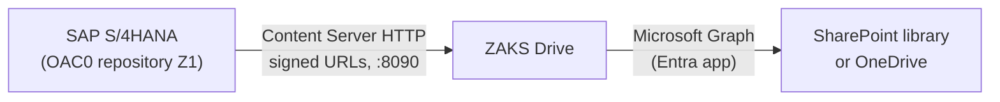

# Connect SAP S/4HANA to SharePoint using ZAKS Drive

This guide takes an SAP Basis or DMS administrator from nothing to an SAP content repository whose documents are stored in SharePoint Online or OneDrive for Business.

> **What this guide does and does not claim.** ZAKS Drive implements the SAP Content Server HTTP interface (pVersion 0045 to 0047). SAP's own test reports RSCMSTH0, RSCMSTH1, RSCMSTH2, RSCMSTH3, RSCMSTA0 and RSCMSTAC passed on S/4HANA 2025 (see [verified against a real SAP system](content-server.md#verified-against-a-real-sap-system)). A complete business scenario (creating a document in CV01N and opening it in CV03N, GOS attachments, ArchiveLink) has **not** been validated end to end. Sections 6 and 7 say what is known. This is not an SAP certification.

## 1. What you are building



SAP treats ZAKS Drive as an HTTP content server. ZAKS Drive stores each SAP document as a folder of files in one SharePoint library and keeps SAP's metadata beside them. There is no database.

## 2. Prerequisites

| Item | Needed |
|---|---|
| A Linux host with Docker, reachable from the SAP application servers on the Content Server port (8090 by default) | [Installation](../installation.md) |
| A Microsoft Entra application with a Graph permission and, for `Sites.Selected`, a site grant | [Entra registration](../microsoft-365/entra-app-registration.md), [Graph permissions](../microsoft-365/graph-permissions.md) |
| A SharePoint library for the documents | [SharePoint configuration](../microsoft-365/sharepoint-configuration.md) |
| SAP authorisations for OAC0, STRUST and the test reports; SAP Basis support | |

## 3. Start ZAKS Drive with the SAP interface

In `deploy/.env` set the Graph credentials and the SharePoint location. In `deploy/config.yaml` (copied from `config.example.yaml`):

```yaml
server:
  interfaces: [rest, contentrepo]      # contentrepo is off by default

contentServer:
  repositories:
    - contRep: Z1                      # must equal the repository ID created in OAC0
      description: SAP documents in SharePoint
      signature: required              # keep required outside of tests
```

Start it and check:

```bash
docker compose -f deploy/docker-compose.yml up -d
docker compose -f deploy/docker-compose.yml exec adapter /zaks-drive check
curl -sS 'http://localhost:8090/ContentServer/ContentServer.dll?serverInfo&pVersion=0047'
```

`check` must show the SharePoint access steps passing; the second command must list `Z1` with status `running`. Full key reference: [configuration](../configuration.md#contentserver-sap).

Network restriction: `contentServer.allowedNetworks` limits which source addresses may call the interface. Use it in addition to signatures, not instead of them.

## 4. Create the repository in OAC0 and activate the certificate

Follow [OAC0 configuration and certificates](oac0-configuration.md). In short:

1. Create repository `Z1`: storage type `04`, document area `DMS`, version `0047`, your host and port, script `ContentServer/ContentServer.dll`.
2. Run the connection test.
3. **Send certificate**, then `zaks-drive certs list`, compare the fingerprint with STRUST, then `zaks-drive certs activate Z1 '<authId>'`.

Without step 3 every signed request fails with [`CS_CERT_INACTIVE`](../error-codes.md#cs_cert_inactive).

## 5. Test with SAP standard tools

Run these reports from SE38 against repository `Z1`. They are SAP's own and need no ABAP development. Watch the ZAKS Drive log while they run (`docker compose -f deploy/docker-compose.yml logs -f adapter`).

| Report | What it exercises | Result recorded for ZAKS Drive (2026-10-16) |
|---|---|---|
| RSCMSTH0 | Connection, `serverInfo`, `putCert` | Passed |
| RSCMSTH1 | Create, read, update, delete of documents | Passed |
| RSCMSTH2 | Document protection (`docProt`), Content-Type round trip | Passed |
| RSCMSTH3 | `mCreate` | Passed |
| RSCMSTA0, RSCMSTAC | SAP's API layer, with caching | Passed |
| RSCMSTAT | Transport between repositories | Not run |
| RSCMSTHS | Stress / multiple components | Not run |

Run the two that were not run before relying on the repository for transports or bulk loads, and record your own results; these results belong to one SAP system and one ZAKS Drive version.

If a report fails, the SAP message alone is rarely enough. The ZAKS Drive log line `request refused` names the error code, status, title and the document; look the code up in [error codes](../error-codes.md).

## 6. Use it from DMS

The intended path is: DMS document type, storage category pointing to `Z1`, then CV01N/CV02N/CV03N. What each step needs, and what has been confirmed, is in [DMS integration](dms-integration.md).

Status: the protocol side works (section 5). In the one system tested, originals created in CV01N did not reach `Z1`, because the DMS storage category and the KPro setting were not yet pointed at it. That configuration is described as steps to verify, not as a confirmed procedure.

## 7. Other SAP use cases

| Use case | Protocol needs | Status |
|---|---|---|
| DMS originals via KPro | Content Server 4.5 | Protocol verified; end-to-end scenario open ([DMS](dms-integration.md)) |
| GOS attachments, ArchiveLink | Content Server 4.5, OAC3 / OAD* assignments | Same commands; not tested ([GOS and ArchiveLink](kpro-gos-archivelink.md)) |
| Custom applications | REST API | Verified with the emulator and a real tenant ([REST API](../api/rest-api.md)) |
| Print-list attribute search (`attrSearch`) | Not implemented | Answers 501 |
| CSADMIN (`adminContRep`) | Not implemented | Answers 501 |

## 8. Operate it

- Monitor `/readyz` and the Prometheus metrics: [monitoring](../operations/monitoring.md).
- Back up the SharePoint library, not the container: [backup and recovery](../operations/backup-recovery.md).
- Do not edit files in the content server folder by hand: [content server consistency](content-server.md#consistency-concurrency-and-recovery).
- Secrets and exposure: [security](../operations/security.md).

## 9. When something fails

See [SAP troubleshooting](troubleshooting.md) for symptoms from SAP's side, and [error codes](../error-codes.md) for every `X-ErrorCode` ZAKS Drive can return.
